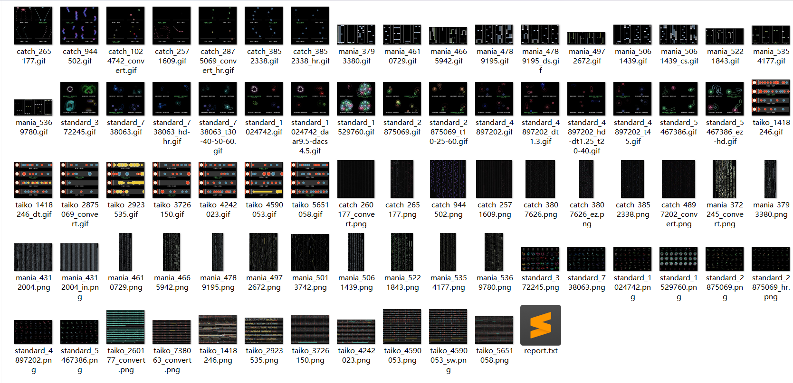

<div align="center">

# osu! Beatmap Preview

[](https://github.com/2710165659/osu-beatmap-preview/releases)
[](LICENSE)
[](https://www.rust-lang.org/)

[中文](README.md) | [English](docs/README.en.md)

</div>

独立的 osu! 谱面与回放预览工具：四模式谱面可导出 PNG、GIF、MP4，也可在浏览器中实时播放，并支持回放预览。



## 功能

- **四模式谱面预览**：支持 osu!standard、osu!taiko、osu!catch、osu!mania，分别提供静态概览、分段动图和带音乐的视频。
- **回放预览**：读取本地 `.osr`、在线成绩或玩家成绩，还原光标、按键、判定与成绩 HUD；CLI 支持 GIF/MP4，Web 支持实时播放与跳转。
- **Mod 与转谱**：支持难度、可见性、速度及模式专属 Mod；Standard 可转为 Taiko、Catch 或 Mania，具体范围见 [CLI 文档](crates/osu-beatmap-preview-cli/README.md#mod-支持)。
- **音画合成**：MP4 与 Web 支持背景图、背景视频、故事板和打击音，优先使用谱面自带音效。背景视频与故事板在 CLI 默认关闭，在 Web 页面默认开启。
- **本地与在线资源**：支持按谱面 ID 下载，或读取本地 `.osu`、`.osz`；外部谱面可搭配媒体包使用，回放按原始谱面的 MD5 校验。
- **单文件 CLI**：内嵌皮肤、字体及 H.264/AAC 编码器，运行无需 FFmpeg 或额外资源。Windows 自动尝试 NVENC/AMF，失败后使用 CPU 编码。

## 快速开始

从 [Releases](https://github.com/2710165659/osu-beatmap-preview/releases) 下载 CLI 或 Web 包，两者可独立使用。

### CLI 导出

CLI 提供 Windows x64、Linux x64、macOS Intel 和 Apple Silicon 产物。以下示例假定已将程序命名为 `osu-beatmap-preview-cli` 并加入 `PATH`；Linux/macOS 首次运行前需要添加执行权限。

```bash
# 在线谱面：Standard 默认 GIF，其他模式默认 PNG
osu-beatmap-preview-cli --bid=738063

# 从本地谱面包导出视频，多难度包用 --bid 选择
osu-beatmap-preview-cli --osz-file=map.osz --bid=738063 --fmt=mp4

# 回放：默认 MP4，需要匹配的完整谱面包
osu-beatmap-preview-cli --type=osr --osr-file=play.osr --osz-file=map.osz
```

成功后 stdout 返回 JSON，`preview-img` 为产物绝对路径。参数、Mod、选段和配置见 [CLI 使用说明](crates/osu-beatmap-preview-cli/README.md)。

### Web 实时预览

Web 包需要 Node.js 18+ 和支持 WebGPU 的浏览器。解压后在包目录运行：

```bash
node backend/server.js
```

访问 [http://127.0.0.1:8787](http://127.0.0.1:8787)，选择「谱面预览」或「回放预览」。支持本地文件、Mod 切换、倍速、跳转、音量、分辨率与帧率设置；在线分享链接为 `/bids/<谱面ID>` 和 `/scores/<成绩ID>`。

在线回放下载与按 MD5 自动查谱需要部署者配置官方 API 凭据；本地回放搭配匹配的完整谱面包可离线使用。运行、认证及 HTTPS 部署见 [Web 站点说明](crates/osu-beatmap-preview-web/README.md)。

## 文档

| 文档 | 内容 |
| --- | --- |
| [CLI 使用说明](crates/osu-beatmap-preview-cli/README.md) | 下载、谱面与回放导出、参数、Mod、配置、缓存与日志 |
| [Web 站点说明](crates/osu-beatmap-preview-web/README.md) | 预览来源、分享链接、启动参数、后端接口与部署 |
| [WASM 使用说明](crates/osu-beatmap-preview-wasm/README.md) | 构建、JavaScript API、音频接入与宿主职责 |
| [批量渲染报告](docs/report.md) | 已记录的性能与资源占用数据 |
| [更新记录](CHANGELOG.md) | 各版本的主要变化 |
| [第三方声明](docs/THIRD_PARTY_NOTICES.md) | 编解码器、字体、音效及前端依赖的许可 |

## 从源码构建

CLI 需要稳定版 Rust 和可用的 C/C++ 编译环境：

```bash
git clone https://github.com/2710165659/osu-beatmap-preview.git
cd osu-beatmap-preview
cargo build --release
```

默认构建 CLI，产物为 `target/release/osu-beatmap-preview-cli`（Windows 加 `.exe`）。运行 Rust 测试：

```bash
cargo test --workspace --all-features --all-targets
```

Web 前端构建需要 Node.js 20.19+；WASM 还需要 `wasm32-unknown-unknown` 目标和与 `Cargo.lock` 一致的 `wasm-bindgen-cli`。完成 [WASM 构建准备](crates/osu-beatmap-preview-wasm/README.md#构建) 后运行：

```bash
cd crates/osu-beatmap-preview-web
npm install
npm run build:wasm
npm run build
npm test
npm start
```

Windows 可运行该目录的 `run_web.ps1` 完成安装依赖、构建和启动；Docker 用法见 [Web 站点说明](crates/osu-beatmap-preview-web/README.md#docker-部署)。

## 许可证

项目代码采用 [MIT License](LICENSE)。内嵌编解码器、Torus 字体和回放提示音适用各自许可，详见 [第三方声明](docs/THIRD_PARTY_NOTICES.md)。
