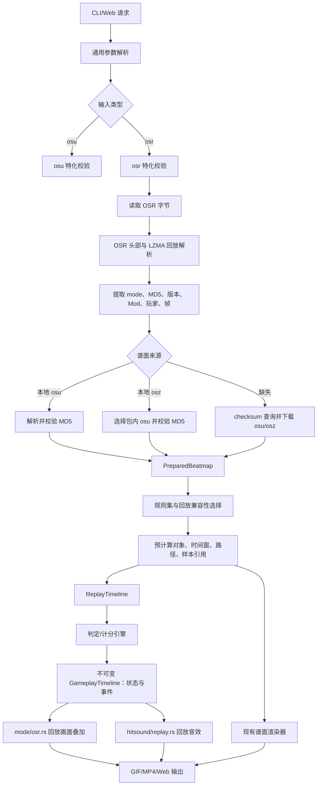

# OSR 回放预览架构设计：概览与实际业务流程

返回入口：[架构设计总览](../osr-architecture.md)。

## 1. 设计目标与边界

本文只定义模块边界、依赖方向、数据契约和迁移顺序，不实现代码。目标是把「读取文件」「解析格式」「准备谱面」「回放输入」「判定计分」「画面叠加」「打击音」「媒体输出」分开，使后续增加 stable、CL、AL、四模式和 Web 实时回放时只替换相应模块。

第一版支持：

- 输入类型 `osu` 与 `osr`，默认 `osu`；OSR 来源只接受手动指定的 `--osr-file`，可以同时指定 `.osu`/`.osz`。
- OSR 手动输入；没有本地 `.osu`/`.osz` 时，使用 OSR 中的谱面 MD5 调用官方 API 查询并下载谱面。
- 没有 `.osz` 时，为 MP4/GIF 下载对应谱面包；下载失败直接报错。
- OSR 输出 `gif`、`mp4` 和 Web 实时预览，省略 `--fmt` 时默认为 `mp4`。
- 第一阶段只实现 Standard 的回放判定与回放叠加。
- OSR 模式禁止 `--convert` 和 `--mod`。回放自身声明的 Mod 必须被识别；首版不支持的 Mod 直接报错。

当前已实现 stable 回放及隐式/显式 `CL`，客户端与分数版本不设白名单。以下行为暂不实现，但架构必须保留扩展点：`AL` 以及 Taiko/Catch/Mania 的回放判定和计分。首版已有 Mod 指项目现在支持的 Mod；能用于谱面预览并不等于已经实现其回放判定，必须同时通过对应规则的能力检查。

### 当前代码依据与必须调整的边界

本项目基于工作区现状分析（基线提交 `ddddf2050ee0c8e85255385b13a0428296303f5e`，含已有暂存修改）；游戏参考目录为 `E:/MyCodes/c#/PROJECTS/osu`（提交 `9469cab82c2a342511021b1c190c50808b237d01`）。

| 当前入口/实现 | 实际行为 | 本次设计决策 |
| --- | --- | --- |
| CLI `cli.rs` → `application/request.rs` → `execute.rs` → `legacy.rs` | 扁平参数收集；两阶段校验；legacy 负责来源、转谱、媒体和输出派发 | 参数和校验分支拆开；提取共用来源与输出编排，不再把回放堆到 legacy |
| `application/local.rs` | 按 BeatmapID 选 OSZ 顶层难度，外部 osu 可覆盖；单独 osu 不支持 MP4 | osu 原规则保留；OSR 必须按原始字节 MD5 选择，缺 OSZ 必须联网取得 |
| core `domain/parser`、`domain/rulesets` | 前者解析 osu，后者只有转谱实现 | 分开 osu/osr 解析；四模式判定放 calculate，不混入转谱模块 |
| core `gameplay.rs`、CLI `application/ports.rs` | 数据和 trait 占位；gameplay 字段尚未接入，CLI 另有 GameplayTimeline 占位 | 保留有用数据，升级事件契约；移除重复占位，不能宣称现有接口已支持回放 |
| Standard `context.rs`/`stacking.rs`/`slider.rs` | HR、堆叠、难度与路径准备在 CPU 渲染内；WGPU 又复用 CPU context | 必要几何和规则准备下移为共享模块，calculate 禁止反向依赖 render |
| Standard `frame.rs`、WGPU `modes/standard.rs` | 物件按谱面时刻消退；光标和 FL 可来自 autoplay | 回放不只是 HUD：物件命中/消退、滑条追踪、转盘、FL 必须读取真实结果 |
| CLI `export/standard/animation.rs`、`video.rs` | GIF/MP4 使用每线程绘制缓存并行产帧 | 判定先顺序预计算，再提供只读查询，不能让线程共享一个可变判定器 |
| core `api/session.rs`、`hitsound` | 实时单时钟、seek/audioEpoch、约 170ms 音频预读；音效按谱面自动展开 | 时钟保留；回放结果一次编译，画面和预读音频各自查询，互不推进对方状态 |
| WASM `lib.rs`/`archive.rs`、Web `preview.js` | 单份 osu/osz 字节入口；浏览器解包解码；Node 只取资源 | 新增回放与谱面双资源入口；MD5 查询在 Node，OSR 不上传服务器 |

参考源码的重要规则：`LegacyScoreDecoder.cs` 同时处理旧帧、负时间、占位帧及 lazer 扩展 JSON；`OsuReplayFrame.cs`/`OsuFramedReplayInputHandler.cs` 区分按键动作与光标插值；`OsuModClassic.cs` 改变滑条判定、note lock 和尾音，stable 回放由解码器隐式追加 CL，并不保证文件位掩码带 CL；`ComboEffects.cs` 的断连音有阈值/首断策略；`ReplayPlayer.cs` 在输入耗尽后才允许失败。当前源码会迁移历史计分和评级；重播按当前标准化规则重算，保留原始成绩和差异诊断，不覆盖 OSR 记录。

## 2. 实际业务流程

请求校验分为两层。第一层只检查参数语法、互斥关系和文件扩展名；第二层在 OSR 和谱面都解析后检查规则能力、MD5 一致、回放 Mod 可用、输出格式可用。首版原生 Standard 要求谱面/回放模式一致；未来 Standard 转其他模式按注册的转换策略、seed 和版本检查，不能在通用校验中永远拒绝模式不同。这样入口不复制业务规则，也不会为校验路径重新读取文件。

OSR 的谱面来源优先级为：显式 `.osu` > 显式 `.osz` 中匹配 MD5 的 `.osu` > 按 OSR MD5 查询官方 API。显式来源不匹配立即报错，不能悄悄换成网络版本。MD5 在任何转谱、换行归一化和 Mod 应用前对原始 `.osu` 字节计算；相同 BeatmapID 不能替代 MD5 校验。

输入 OSR 但没有 OSZ 时，无论是否指定 osu、无论 GIF/MP4/Web，都查询所需 set id 并联网下载 OSZ；下载失败报错。已提供 OSZ 时不再下载，按 MD5 找到难度并提供媒体。OSZ 缺音乐或音乐解码失败保持致命错误；缺背景和缺个别音效复用现有降级规则。官方 checksum 查询已实测成功；CLI/Node 仍需新增 OAuth 查询适配器，凭据不能写入浏览器或 core。无授权或谱面离线不可查时允许用户提供 OSZ，不能绕过 MD5。

osu 分支保持现有流程：获得 osu → 原模式/目标模式确定 → 原校验和默认输出 → 现有转谱/媒体/渲染。两分支在“已准备谱面、资源、时间段、输出计划”处汇合，不强制 osu 经过回放编译。

